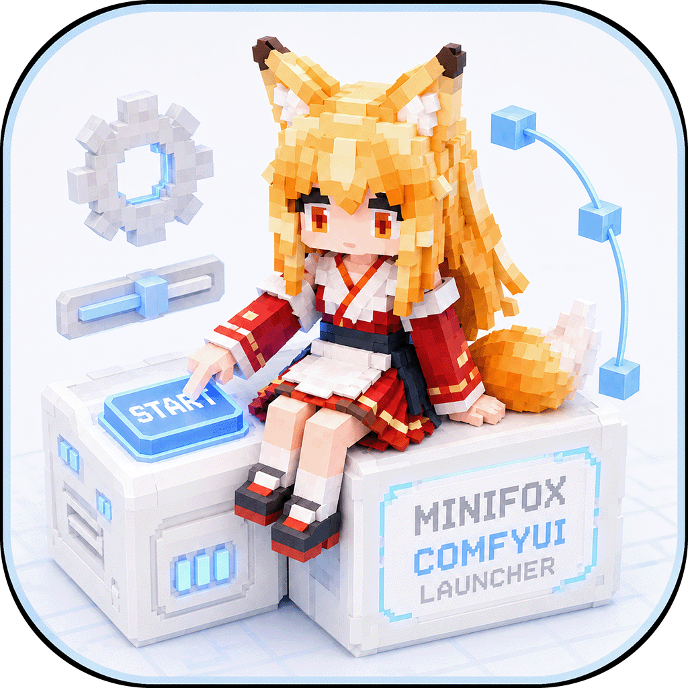

<div align="center">
  
  <h1>Minifox ComfyUI Launcher</h1>
  <p><strong>面向 Windows 的便携式单文件 ComfyUI 启动器</strong></p>
  <p><a href="README.md">English</a> · 简体中文</p>
  <p>
    
    
    
    <a href="LICENSE"></a>
  </p>
</div>

Minifox 是面向 Windows 10/11 x64 的便携式 ComfyUI 启动器，专门用于配置、启动和管理 ComfyUI。程序使用 Qt 6、Qt Quick、C++20、QML 和 CMake 开发，可构建为无需附带 Qt DLL 的单文件 EXE，直接放入现有 ComfyUI 整合包使用。

Minifox 不使用 Windows 注册表。常规配置和启动过程不会修改 ComfyUI 文件；启动器只会在 EXE 同级目录创建便携数据和缓存目录。只有用户明确执行版本更新、版本切换、安装或移除扩展、清理操作时，才会修改对应的 ComfyUI 文件。

## 主要功能

- 几乎没有预设启动参数（完全由 ComfyUI 决定），支持多套启动配置无缝切换
- 启动、停止并实时监控 ComfyUI 进程、运行状态与控制台输出
- 管理 ComfyUI 核心与扩展/自定义节点（Custom Nodes）版本，配有“刷新列表”和“一键更新”按钮，并保留本地修改
- 自动识别 CUDA、ROCm 及适用的 ZLUDA 环境
- 提供模块化与可自定义的组件以个性化首页

## 快速上手

将 `Minifox ComfyUI Launcher.exe` 放入 ComfyUI 整合包目录中直接运行：

```text
ComfyUI-Package/
├── Minifox ComfyUI Launcher.exe
├── ComfyUI/
│   ├── main.py
│   └── ...
└── python/
    ├── python.exe
    └── ...
```

启动器会自动识别常见的便携式目录结构，也可以在启动配置中手动选择 Python 和 ComfyUI 路径。

## GPU 与 ZLUDA

启动器打开后不会立即显示环境信息。启动 ComfyUI 时，启动器会截获日志并将相关信息展示在首页卡片上，同时可在控制台中查看检测过程：

| 环境 | 行为 |
|---|---|
| CUDA 或 ROCm | 使用原生 PyTorch |
| 仅 AMD 显卡与 CUDA PyTorch | 自动准备 ZLUDA |

ZLUDA 注入的优先级最低。

> **兼容性说明：** HIP SDK 5.7 + ZLUDA 已通过测试。任何使用 CK（Composable Kernel）或 MIOpen 的内容均未测试，不应视为已受支持或稳定可用。

> **另附建议：** HIP SDK 7.1 + ZLUDA 的组合受支持，但其显存占用不如 HIP SDK 5.7 组合稳定。强烈建议 AMD 显卡使用原生 PyTorch（正式版或 ROCm Preview 7.14 及之后版本）。如果使用 ZLUDA，建议搭配兼容的 Triton wheel，以获得更好的算子兼容性和性能。

### AMD ZLUDA 前置条件

1. 使用 AMD 官方安装器安装 HIP SDK（安装器会自动设置 `HIP_PATH` 环境变量）。
2. HIP 目录中必须包含适用于当前显卡 `gfx` 架构的 rocBLAS/Tensile 库文件：

   ```text
   <HIP_PATH>\bin\rocblas\library\
   ```

   > [!NOTE]
   > 如果您的显卡架构不在官方支持列表中，需要在该目录下手动补充对应的 Tensile/rocBLAS 文件。

3. 使用原本面向 NVIDIA 显卡的 ComfyUI 整合包（PyTorch 需要重装为兼容版本）。

Minifox 内置了 HIP SDK 5.7 和 HIP SDK 7.1 的 ZLUDA 运行组件，但不内置针对特定 `gfx` 架构的 rocBLAS/Tensile 补丁。

除用户明确执行的版本管理操作和临时 ZLUDA 部署外，启动器不会修改 ComfyUI 源文件、HIP 安装文件或系统环境变量。ZLUDA 会作为 PyTorch 的运行时补丁，临时替换部分必要文件，并在启动器关闭时恢复原文件。已解压且版本未变化的运行包不会重复解压，已有缓存会继续复用。

### 界面渲染

启动器界面默认使用 Direct3D 11，并关闭 flip 交换链（`QT_D3D_NO_FLIP=1`）。部分 AMD 核显在 flip 模式下拖动缩放窗口会明显卡顿，关闭后与 OpenGL 一样流畅，而常驻内存比 OpenGL 或 Vulkan 少约 120 MB。如遇显卡驱动兼容问题，可在启动前自行设置环境变量 `QSG_RHI_BACKEND=opengl`（或 `vulkan`）切换后端，已设置的值不会被覆盖。

## 版本管理

内核页可查看稳定版、开发版、远程分支和历史提交；扩展页可查看已安装扩展的当前分支、版本、日期、远程仓库和更新状态。扩展还可以从插件目录或 Git 地址安装，以及启用/禁用、移到回收站、切换版本。

- 打开页面或切换标签时只读取本地信息和缓存的插件目录；只有点击“刷新列表”才会联网检查。更新尚未检查过的项目时，会在这次点击中先拉取一次。刷新不会修改工作目录。
- 更新和切换版本会保留本地修改：本地修改先记录为一个私有提交，再与目标版本合并。本地修改与远端更新改到同一处时（删除和二进制文件按整个文件计），采用远端版本，被替换的修改会备份（见下文）。存在本地修改时需要 Git 2.40 或更新版本。
- 未跟踪文件不受影响。与目标版本中文件冲突的未跟踪文件或文件夹（包括只有大小写不同的情况）会移到备份中，而不是让操作失败。
- “本地修改”一行的“放弃修改…”会先备份修改过的文件，再把该仓库恢复为当前版本。
- “完全清理”（在设置页）会放弃本地修改，并把所有未被 Git 忽略的未跟踪文件移到备份中，使工作目录恢复为当前版本的干净状态。
- 每个操作都会记录日志。如果启动器中途被中断，下次启动会自动把仓库撤销到操作之前的状态；撤销成功前不能启动 ComfyUI，版本管理页会提供重试按钮。
- 版本变更后会离线检查依赖，只有确实缺少时才会在可见的控制台中运行 pip。
- 扩展版本切换会显示提交说明、日期和当前版本，不需要手动输入提交 ID。
- 按住 `Ctrl` 并左键单击远程仓库地址，可在默认浏览器中打开该地址。

### 备份位置

操作替换或放弃本地修改、或移走未跟踪文件时，这些内容会保存在 **ComfyUI 文件夹的上级目录**，与 `ComfyUI/` 同级：

```text
ComfyUI-Package/
├── ComfyUI/
└── backup/
    └── YYYY-MM-DD/
        └── <仓库名>-HHmmss/
            ├── files/            被替换或放弃的文件的本地版本
            ├── untracked/        被移走的未跟踪文件
            ├── conflicts.log     替换了哪些内容以及如何恢复
            └── conflicts.patch   可重新应用被替换修改的补丁
```

全部本地修改还会以 Git 提交的形式保存在对应仓库的 `refs/minifox/backups/` 下。最多保留最近 30 个日期目录，每个仓库保留最近 20 个备份引用，更早的会自动清理。操作日志保存在 EXE 旁的 `.minifox/versioning/`。这些备份不能代替另一块磁盘上的备份。

## 便携数据

程序按需在 EXE 旁创建：

```text
.minifox/
├─ application-settings.json
├─ launch-profiles.json
├─ custom-node-list.json
├─ icons/
│  └─ custom.png
├─ skins/
├─ packages/
├─ runtime/
└─ versioning/
.cache/
├─ zluda/
├─ triton/
└─ torchinductor/
```

`.minifox` 与 `.cache` 会自动设为隐藏目录。`.cache` 中的内容只会在使用 ZLUDA 时写入和读取；NVIDIA、原生 ROCm 及其他非 ZLUDA 启动路径不会使用该目录。

## 构建要求

- Windows 10/11 x64
- MSYS2 UCRT64 GCC，支持 C++20
- CMake 3.25+ 与 Ninja
- Qt 6.8+：Core、Concurrent、Gui、Network、Qml、Quick、QuickControls2、LinguistTools，以及仅测试时需要的 Test

当前已使用 Qt 6.12.0、GCC 16.2.0、CMake 4.4.4 和 Ninja 1.13.2 验证；本地开发也可使用 MSVC 2022 与官方 Qt 6.12.0 构建和运行测试。

### 安装依赖

在“MSYS2 UCRT64”终端中执行：

```bash
pacman -Syu
```

如果终端要求重启，请关闭后重新打开，再安装动态 Qt 构建依赖：

```bash
pacman -S --needed \
  mingw-w64-ucrt-x86_64-toolchain \
  mingw-w64-ucrt-x86_64-cmake \
  mingw-w64-ucrt-x86_64-ninja \
  mingw-w64-ucrt-x86_64-qt6-base \
  mingw-w64-ucrt-x86_64-qt6-declarative \
  mingw-w64-ucrt-x86_64-qt6-tools
```

如需生成无需 Qt DLL 的单文件 EXE，再安装静态 Qt：

```bash
pacman -S --needed \
  mingw-w64-ucrt-x86_64-qt6-static \
  mingw-w64-ucrt-x86_64-libwebp \
  mingw-w64-ucrt-x86_64-libtiff
```

静态 Qt 安装体积较大，请预留至少 4 GB 空间。

## 构建

在 Windows PowerShell 中进入仓库根目录。

调试版、QML 检查和单元测试：

```powershell
.\scripts\build.ps1 -Preset ucrt64-debug -RunTests
```

动态 Release：

```powershell
.\scripts\build.ps1 -Preset ucrt64-release
```

> 动态版是开发构建，不会自动复制 Qt DLL、QML 模块和插件，不能作为单文件直接分发。需要部署动态版时，请另外使用 `windeployqt` 收集运行依赖。

单文件静态 Release：

```powershell
.\scripts\build.ps1 -Preset ucrt64-static-release
```

静态版输出：

```text
build/Release/Minifox ComfyUI Launcher.exe
```

如果 MSYS2 不在 `C:\msys64`，可传入安装目录：

```powershell
.\scripts\build.ps1 -Preset ucrt64-static-release -Msys2Root "D:\msys64"
```

也可以设置环境变量：

```powershell
$env:MINIFOX_MSYS2_ROOT = "D:\msys64"
.\scripts\build.ps1 -Preset ucrt64-debug -RunTests
```

若 PowerShell 阻止本地脚本，可仅为当前进程放行：

```powershell
Set-ExecutionPolicy -Scope Process Bypass
```

### 手动构建

首次配置应使用目标 Qt 自带的 `qt-cmake.bat`。静态预设必须使用静态 Qt 的 `qt-cmake.bat`。

动态 Debug：

```powershell
$env:Path = "<MSYS2>\ucrt64\bin;$env:Path"
& "<MSYS2>\ucrt64\bin\qt-cmake.bat" --preset ucrt64-debug
cmake --build --preset ucrt64-debug
cmake --build --preset ucrt64-debug --target all_qmllint
ctest --preset ucrt64-debug
```

单文件静态 Release：

```powershell
$env:Path = "<MSYS2>\ucrt64\bin;$env:Path"
& "<MSYS2>\ucrt64\qt6-static\bin\qt-cmake.bat" --preset ucrt64-static-release
cmake --build --preset ucrt64-static-release
```

| 预设 | 用途 | 输出 |
|---|---|---|
| `ucrt64-debug` | Debug、QML 检查和单元测试 | `build/debug/` |
| `ucrt64-release` | 动态链接 Release | `build/release/` |
| `ucrt64-static-release` | 单文件静态 Release | `build/Release/` |

## 源码结构

```text
app/                         应用入口、页面组合和应用级后端
core/configuration/          启动配置、参数目录和高级选项
core/application-settings/   主题、语言、代理和应用设置
core/runtime/                命令、依赖检查、进程、日志和控制台
core/skin/                   皮肤、资源导入导出和首页布局
shared/                      通用 C++ 能力、主题和 QML 控件
platform/windows/            Windows 平台实现
assets/zluda/                内置通用 ZLUDA 运行包
scripts/                     可复现构建入口
.github/workflows/           GitHub Actions 编译与测试
```

业务依赖方向：

```text
Minifox.App UI -> Configuration / Runtime / ApplicationSettings UI -> Minifox.Shared UI
app backend    -> core backends                                  -> shared / platform
```

QML 不直接读写配置文件或操作进程，页面通过 `appContext` 调用 C++ 后端。

生成的构建目录、可执行文件、便携运行数据和本机缓存均不进入版本控制；仓库只保留源码、内置资源和可复现构建配置。

## 持续集成

GitHub Actions 在 Windows UCRT64 环境中执行：

1. Debug 配置与编译
2. QML 静态检查
3. C++ 单元测试
4. 单文件静态 Release 编译验证

推送和 PR 触发的运行只验证源码，不上传任何产物；手动运行（`workflow_dispatch`）还会把单文件 EXE 作为测试产物上传，一天后过期。

## 配置包和运行包校验

本地启动命令预览完整显示配置的环境变量值和实际参数。导出配置提供两种模式：“分享启动选项”只包含预设选项和数值参数；“完整备份”保留原始配置，包括环境变量和自由文本参数。分享导出不包含界面状态，导入时保留接收方现有的界面状态。

配置包只交换应用设置、皮肤 JSON、皮肤图片和自定义图标。运行时代码、内置包缓存、版本事务与恢复备份不参与导出或配置切换。包含受保护文件、重复路径或 Windows 路径别名的旧包会被拒绝；请从可信配置用新版重新导出。合法的嵌套皮肤图片和大写图片扩展名仍受支持。

配置切换先保存 `.minifox/configuration-state.pending.zip`，再替换数据并提交配置选择。若进程中断，下次启动会在加载设置前恢复原配置；恢复失败会保留记录并停止启动。请保留该文件和整个 `.minifox` 目录。文件写入已进行刷盘和回读验证，但尚未进行真实硬件断电测试。

依赖安装直接用 Python 参数数组运行，日志与错误通过启动器显示，不再生成或执行安装批处理。版本管理调用 Git 时会加上 `-c safe.directory=*`，避免在不同磁盘或用户之间复制的便携包被 Git 以“dubious ownership”拒绝；这只作用于启动器自己启动的 Git 进程，不会修改你的 Git 配置。

内置 ZLUDA 包通过 `assets/zluda/manifest.json` 验证归档及每个 DLL；缓存、解包目录和加载目录均检查内容身份。相同且完整的 DLL 可在占用时复用，非预期文件会阻止启动。`MINIFOX_ZLUDA_DIR` 只接受用户明确选择的绝对路径，该目录属于用户信任的可执行代码，不是内置包的认证来源。清单校验不等于对上游二进制安全性的证明。

## 鸣谢

- 感谢 [ZLUDA 项目及社区](https://github.com/vosen/ZLUDA) 对非 NVIDIA GPU 运行 CUDA 应用所做的长期探索与贡献。
- 感谢 B 站 UP 主 [秋葉aaaki](https://space.bilibili.com/12566101) 及秋叶启动器为国内 ComfyUI 用户提供的整合、启动器实践与经验。

## 许可证

本项目采用 [GNU General Public License v3.0](LICENSE)（`GPL-3.0-only`）发布。

你可以使用、复制、修改和分发本项目。分发修改版或衍生作品时，必须遵守 GPLv3，包括向接收者提供相应源码并保留 GPLv3 授权。完整条款见 [LICENSE](LICENSE)。
